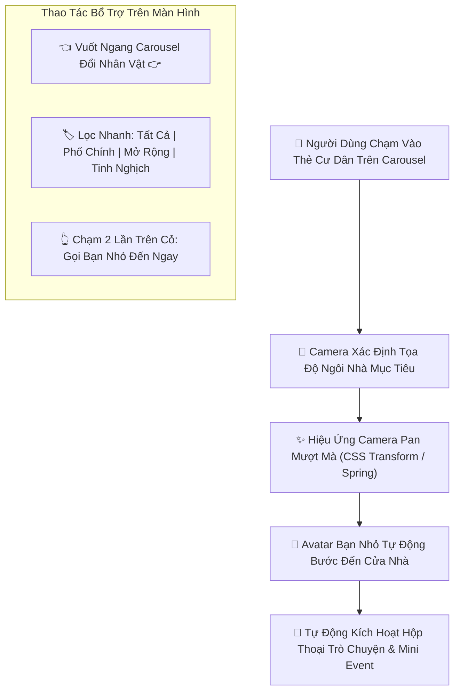

# Kế Hoạch & Lộ Trình Thay Đổi Layout Cho Mobile (Mobile Layout Plan - Solution 3)

Tài liệu này lưu trữ lộ trình chi tiết triển khai **Giải Pháp 3 (Bottom Carousel Bar / Drawer)** cho phiên bản màn hình di động (Mobile Web) của **Thị Trấn Sao Bông**.

---

## 1. TỔNG QUAN GIẢI PHÁP & TRIẾT LÝ THIẾT KẾ

### 1.1. Vấn đề thực tế trên Mobile
* Trên màn hình điện thoại tỉ lệ dọc (`9:16` hoặc `9:19.5`), diện tích chiều ngang rất hẹp (`360px – 430px`).
* Với số lượng nhân vật tăng lên **20 cư dân** (8 cư dân chính + 8 cư dân mở rộng + 4 cư dân phản diện tinh nghịch):
  * **Nếu xếp tất cả lên 1 màn hình dọc**: Các ngôi nhà sẽ bị chen chúc, đè lấn nhau, che khuất con đường đá và phong cảnh.
  * **Nếu kéo dài trang thành 1 dải cuộn vô tận**: Người dùng phải vuốt tay liên tục qua quãng đường rất dài, dễ gây mỏi tay và mất phương hướng.

### 1.2. Giải pháp 3: Bottom Carousel Drawer kết hợp Camera Pan
* **Giao diện chính**: Giữ khung cảnh sườn đồi thoáng đãng, tập trung vào góc nhìn đẹp nhất với tỉ lệ zoom thoải mái.
* **Thanh trượt ngang cư dân (Bottom Carousel Bar)**: Cố định ở đáy màn hình (vùng ngón tay cái thuận tiện nhất).
* **Cơ chế Camera Smooth Pan**: Khi chạm vào bất kỳ cư dân nào trên Carousel, khung cảnh tự động lia mượt mà và zoom nhẹ đến trước cửa ngôi nhà đó, kích hoạt đối thoại ngay lập tức mà không bắt người chơi phải điều khiển avatar đi bộ quãng đường quá xa.

---

## 2. SƠ ĐỒ KIẾN TRÚC & LUỒNG TƯƠNG TÁC (MERMAID)

---

## 3. LỘ TRÌNH 4 GIAI ĐOẠN THỰC THI (ROADMAP)

### Giai đoạn 1: Thiết Kế Thanh Carousel Cư Dân (Bottom Carousel Drawer)
* **Kích thước & Vị trí**:
  * Cố định ở đáy màn hình (`fixed bottom-0 left-0 right-0 z-40`).
  * Chiều cao thanh: `78px – 84px` (tính cả safe-area padding cho iPhone tai thỏ / thanh điều hướng Android).
  * Nền mờ kính: `bg-white/90 backdrop-blur-md border-t-2 border-[#593A47] shadow-[0_-4px_16px_rgba(89,58,71,0.12)]`.
* **Cấu trúc Thẻ Cư Dân (Resident Card Chip)**:
  * Chiều rộng thẻ: `68px – 74px`, bo tròn góc `rounded-2xl`, viền nâu hạt dẻ `#593A47`.
  * Hình avatar tròn thu nhỏ (`w-10 h-10` hoặc `w-11 h-11`), hiển thị biểu cảm chibi.
  * Nhãn số nhà mini: `Số 01`, `Số 02`, v.v.
  * Tên cư dân: Font chữ đậm nét, cỡ `10px – 11px`, không bị tràn chữ (`truncate`).
  * Trạng thái hoạt động: Chấm đèn nhỏ xanh/vàng biểu thị có nhiệm vụ hoặc mini event trong ngày.
* **Thanh Lọc Nhanh (District Filter Tabs)**:
  * Đặt ngay trên đỉnh thanh Carousel (có thể kéo ẩn/hiện):
    * 🌟 **Tất Cả** (20 cư dân)
    * 🏡 **Phố Chính** (Số 01 – 08)
    * 🌸 **Đồi Mở Rộng** (Số 09 – 16)
    * 🌪️ **Ngõ Gió Xoáy** (Số 17 – 20)

---

### Giai đoạn 2: Cơ Chế Camera Smooth Pan & Auto-Focus
* **Tính toán Tọa độ Camera**:
  * Mỗi ngôi nhà có tọa độ chuẩn hóa `(targetX%, targetY%)` trên sườn đồi.
  * Khi kích hoạt, container sườn đồi dịch chuyển theo công thức:
    $$\Delta X = 50\% - \text{targetX},\quad \Delta Y = 50\% - \text{targetY}$$
  * Giới hạn biên (`clamp`) để camera không bao giờ bị lộ khoảng trắng ngoài bầu trời hoặc rìa ngoài đồi cỏ.
* **Hiệu ứng chuyển động mượt mà (Motion Easing)**:
  * Sử dụng CSS `transition: transform 0.65s cubic-bezier(0.25, 1, 0.5, 1)` hoặc thư viện animation lò xo (`framer-motion` / custom requestAnimationFrame).
  * Kết hợp hiệu ứng zoom nhẹ (`scale(1.15)`): Phóng to ngôi nhà mục tiêu để tạo cảm giác "đặt chân đến thăm nhà".
* **Kích hoạt tương tác tự động**:
  * Khi camera hoàn thành cú lia, tự động kích hoạt đối thoại `handleSelectCharacter(char)` mà không đòi hỏi thao tác bấm thêm.

---

### Giai đoạn 3: Tối Ưu Cảm Ứng & Cử Chỉ Vuốt (Touch Gestures)
* **Vuốt tự do ngắm cảnh (1-Finger Pan Gesture)**:
  * Cho phép người chơi dùng 1 ngón tay vuốt nhẹ trên mặt cỏ để ngắm các góc thị trấn.
* **Chạm đôi để di chuyển (Double-Tap to Walk)**:
  * Chạm 2 lần vào bất kỳ khoảng cỏ nào, avatar bạn nhỏ sẽ tự động bước đến vị trí đó với tốc độ nhanh hơn bình thường x1.5.
* **Thu gọn cụm D-Pad ảo**:
  * Khi ở chế độ Mobile, cụm 4 phím D-pad mặc định thu nhỏ thành 1 nút tròn nổi duy nhất `🚶` ở góc trái dưới để không che khuất màn hình.
  * Người dùng có thể chạm giữ nút này để hiện joystick điều khiển nhanh nếu muốn tự tay đi bộ.

---

### Giai đoạn 4: Tinh Chỉnh Hiệu Năng & Trải Nghiệm Công Thái Học (Thumb Zone)
* **Khu vực bấm ngón cái thuận tiện (Thumb Zone Optimization)**:
  * Mọi nút bấm cốt lõi (Nút mở Hộp Sao, Nút xem Thẻ Sao đã mở, Nút trò chuyện) đều được gom về nửa dưới màn hình để dễ dàng thao tác bằng 1 tay.
  * Kích thước vùng cảm ứng tối thiểu luôn đạt $\ge 44 \times 44\text{ px}$.
* **Tối ưu đồ họa & Tốc độ khung hình (Performance Checklist)**:
  * Áp dụng `content-visibility: auto` và GPU acceleration (`will-change: transform`) cho các ngôi nhà nằm ngoài vùng nhìn.
  * Duy trì tốc độ khung hình ổn định **60 FPS** trên cả các dòng điện thoại iOS / Android phổ thông.
  * Ngăn chặn hành vi zoom ngoài ý muốn khi chạm nhiều lần (`touch-action: pan-x pan-y`, cấm double-tap-to-zoom mặc định của Safari/Chrome).

---

## 4. BẢNG PHÂN CÔNG COMPONENT DỰ KIẾN KHI TRIỂN KHAI

| Tên Component Mới / Sửa | Vị Trí File | Trách Nhiệm Chính |
| :--- | :--- | :--- |
| `MobileResidentCarousel.jsx` | `src/components/` | Render thanh trượt ngang cư dân dưới đáy màn hình, quản lý cuộn ngang và tab lọc khu phố. |
| `TownStreetScene.jsx` | `src/components/` | Quản lý khung camera viewport `(cameraX, cameraY, cameraZoom)` và hiệu ứng smooth pan. |
| `CozyWalkAvatar.jsx` | `src/components/` | Lắng nghe cử chỉ cảm ứng trên mobile, cơ chế tự động chạy đến nhà khi chọn trên Carousel. |
| `useMobileViewport.js` | `src/hooks/` | Hook nhận diện thiết bị mobile, tính toán chiều cao an toàn màn hình (`100dvh`, iOS Safari notch bar). |

---

## 5. KẾT LUẬN & GHI CHÚ
> [!TIP]
> Tài liệu này đã được lưu trữ sẵn sàng tại `plan_mb.md`. Khi bắt tay vào thực hiện, chỉ cần mở file này và triển khai theo đúng trình tự từng giai đoạn từ 1 đến 4.

